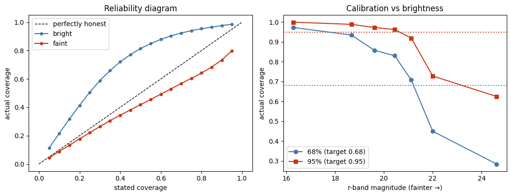
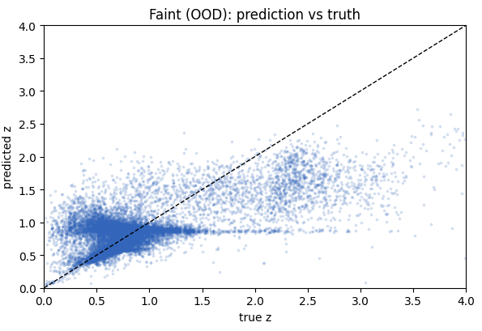
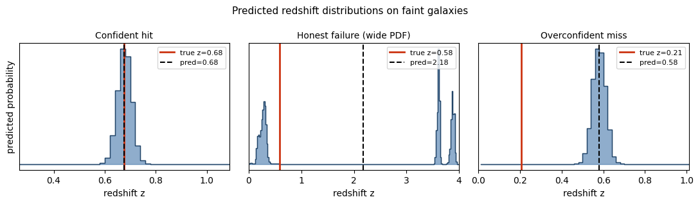

# When the Model Doesn't Know It's Wrong: Photometric Redshift Estimation under a Brightness Shift

Official code repository for the paper **"When the Model Doesn't Know It's Wrong: Accuracy and Calibration of Image-Based Photometric Redshift Estimation under a Brightness Shift"**.

**Authors:** Nirjon Mobarak Talukder, Fardeen Sadab, J. M. Areeb Uzair Alam  
*Department of Computer Science and Engineering, Islamic University of Technology (IUT), Gazipur, Bangladesh*

---

## Overview


Spectroscopic galaxy catalogs used to train deep photometric redshift ($\text{photo-}z$) models are systematically biased toward bright, low-redshift sources, whereas modern wide-field imaging surveys predominantly target faint, distant populations. We formulate this train–test mismatch as a controlled out-of-distribution (OOD) brightness shift on the public **GalaxiesML** dataset ($r$-band split at median $r = 20.31$, inducing a Kolmogorov–Smirnov distance of $0.72$ between redshift distributions).

This repository implements:
1. **Multimodal Distribution-Valued Architecture:** A 4-stage ResNet backbone with Squeeze-and-Excitation (SE) channel attention for $5 \times 64 \times 64$ ($g, r, i, z, y$) image cutouts fused with a 2-layer MLP for catalog photometry (5 cmodel magnitudes + 4 colors), outputting a discretized 200-bin probability distribution over $z \in [0, 4]$.
2. **Soft-Target & Imbalance-Aware Training:** Gaussian-smoothed soft label cross-entropy paired with capped Label Distribution Smoothing (LDS) inverse-density reweighting.
3. **Probabilistic Baselines:** A single-Gaussian heteroscedastic CNN baseline and a 3-component Mixture Density Network (MDN) comparator.
4. **Full-Distribution Calibration Diagnostics:** Evaluation of Probability Integral Transform (PIT), central-interval coverage, and Continuous Ranked Probability Score (CRPS) across the brightness transition.

---

## Repository Structure

```text
.
├── pr-project.ipynb                  # Core data pipeline, EDA, ResNet-SE multimodal training & ablations
├── mdn_with_brightness_shift.ipynb   # Mixture Density Network (MDN) training & magnitude-binned evaluation
├── Result_Analysis.ipynb             # Calibration diagnostics (PIT, CRPS, coverage) & paper figure generation
└── README.md

```

### Notebook Breakdown

* **`pr-project.ipynb`**
* **Data Cleaning & Preprocessing:** Filters the $5 \times 64 \times 64$ GalaxiesML catalog to $204,573$ valid sources ($0 < z \le 4$, finite magnitudes), applies $arcsinh$ dynamic-range compression, and computes per-band standardization using strictly bright-training statistics.
* **Controlled Shift Split:** Partitions galaxies at the median $r$-band magnitude ($r = 20.31$) into bright (train / validation / calibration / ID-test) and faint (OOD-test, $N = 18,000$) pools.
* **Model Training & Ablations:** Trains the heteroscedastic Gaussian baseline and the seeded ResNet-SE ablation grid (`Image-only`, `+ Photometry`, and `Full (+ LDS)`).


* **`mdn_with_brightness_shift.ipynb`**
* Implements the 3-component Gaussian Mixture Density Network ($K = 3$) trained via mixture negative log-likelihood on the identical brightness split and normalization statistics.
* Computes expected-value point estimates, total-variance predictive uncertainties, and $2\sigma$ empirical coverage across $r$-band magnitude bins (Appendix A).


* **`Result_Analysis.ipynb`**
* Evaluates trained checkpoints on the bright (in-distribution) and faint (OOD) test splits.
* Computes point metrics ($\sigma_{\text{MAD}}$, catastrophic outlier fraction $\eta$ at $|\Delta z| > 0.15$, and normalized bias) and distributional calibration metrics (PIT, CRPS, and 68%/95% empirical coverage vs. magnitude).
* Exports publication-ready figures (`calibration_figures.png`, `pred_vs_truth.png`, `qualitative_pdfs.png`, etc.).


---

## Dataset Setup

We use the **$5 \times 64 \times 64$ subset of the GalaxiesML dataset** ([Do et al., 2024](https://arxiv.org/abs/2410.00271)), which provides 5-band ($g, r, i, z, y$) HSC-SSP image cutouts alongside catalog cmodel magnitudes and spectroscopic redshifts.

1. Download the `GalaxiesML` $5 \times 64 \times 64$ HDF5 dataset files.
2. Update the dataset path variable at the top of `pr-project.ipynb` and `mdn_with_brightness_shift.ipynb` to point to your local HDF5 file directory.

---

## Requirements & Installation

Ensure you have Python 3.9+ and a CUDA-capable GPU. Install the required dependencies:

```bash
pip install torch torchvision numpy scipy pandas h5py matplotlib seaborn scikit-learn tqdm

```

---

## Reproducing Results & Figures

To reproduce the experimental tables and figures from the paper, execute the notebooks in the following order:

1. **Train Main Models & Export Predictions (`pr-project.ipynb`):**
Run all cells to generate the shared split indices, exploratory data analysis plots (`redshift_distribution.png`, `snr_magnitude.png`), and model predictions across random seeds.
2. **Run MDN Experiments (`mdn_with_brightness_shift.ipynb`):**
Execute to reproduce the magnitude-binned MAE, mean $\sigma$, and $2\sigma$ coverage reported in Table II (Appendix A).
3. **Evaluate Calibration & Generate Plots (`Result_Analysis.ipynb`):**
Run to compute final aggregated test metrics (Table I) and generate the reliability diagrams, coverage-vs-brightness curves (`calibration_figures.png`), faint scatter plots (`pred_vs_truth.png`), and qualitative PDF examples (`qualitative_pdfs.png`).

---

## Key Results Summary

Evaluated on the held-out **Faint (OOD)** test set ($r > 20.31$) and **Bright (ID)** test set ($r \le 20.31$):

| Model Configuration | Faint $\sigma_{\text{MAD}}$ $\downarrow$ | Faint Outlier $\eta$ $\downarrow$ | Bright $\sigma_{\text{MAD}}$ $\downarrow$ |
| --- | --- | --- | --- |
| **Heteroscedastic Baseline (Image-only)** | $0.0900$ | $0.301$ | $0.0160$ |
| **ResNet-SE (Image-only, Binned)** | $0.0467 \pm 0.0042$ | $0.217 \pm 0.027$ | $0.0100$ |
| **ResNet-SE (+ Photometry)** | **$0.0414 \pm 0.0003$** | $0.193 \pm 0.006$ | **$0.0100$** |
| **ResNet-SE (Full: + Photometry + LDS)** | $0.0432 \pm 0.0017$ | **$0.188 \pm 0.017$** | $0.0112$ |

* **Key Calibration Finding:** While the multimodal binned architecture nearly halves OOD robust scatter ($\sigma_{\text{MAD}}$) compared to the single-Gaussian baseline, full-distribution evaluation reveals a systematic regime shift: models are **underconfident in-distribution** (bright CRPS $= 0.029$) but become sharply **overconfident out-of-distribution** (faint CRPS $= 0.168$, with nominal 68% intervals achieving only $\sim 28\%$ coverage on the faintest sources).






---
